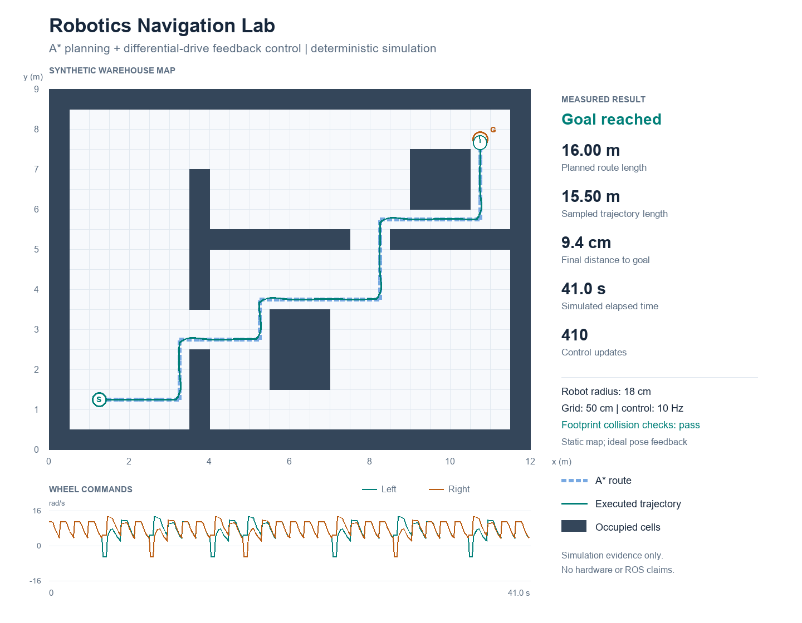

# Robotics Navigation Lab

A small Python project for studying **occupancy-grid planning, differential-drive kinematics and feedback control**. A circular robot navigates a synthetic warehouse map using an A* route and a waypoint controller. Every proposed motion is checked against the robot footprint before being applied.

This is a simulation project. It does not use ROS, a physical robot, camera data, SLAM or a learned model. A* is a classical AI search method; this project makes no machine-learning performance claims.



## Run it

Use Python **3.10 or newer**. The planner, simulator, SVG figure and tests use only the Python standard library.

```bash
python demo.py
python -m unittest discover -s tests -v
```

The demo writes `artifacts/metrics.json` and `artifacts/trajectory.svg`. A successful run exits with status 0; failure to reach the goal or a failed sampled-motion collision check exits with status 1.

For the optional PNG preview shown above:

```bash
python -m pip install -r requirements.txt
python demo.py --png
```

Choose another output directory with `python demo.py --output-dir my-results`. There is no random seed because the map, planning tie-break order and controller are deterministic.

## What is implemented

1. **Map and footprint:** a 24 × 18 grid at 0.5 m resolution. Each occupied cell is a square obstacle. The robot is a circle of radius 0.18 m. Circle-to-square geometry checks obstacle corners and map boundaries.
2. **Global planning:** four-connected A* with Manhattan distance. Every edge has the same physical length; the heuristic is admissible. The returned route is shortest on this footprint-valid grid graph, rather than the globally shortest curve in continuous space.
3. **Feedback control:** the controller points toward successive cell-centre waypoints. Proportional heading feedback steers the robot; linear speed decreases near a waypoint and with heading error. A large heading error causes rotation in place.
4. **Robot motion:** commanded forward speed and yaw rate become left/right wheel rates. A common scale factor enforces the wheel-rate limit while preserving curvature. Constant-wheel-rate differential-drive motion is integrated using its exact arc equations.
5. **Collision guard:** proposed arcs are sampled at no more than 0.02 m translation and 0.04 rad rotation between checks. An unsafe command loses its translation and keeps its rotation. Failure and timeout are reported explicitly.
6. **Evidence:** the demo exports measured distances, final error, simulated time, wheel speeds and collision-check outcomes, alongside the map and command traces.

### Kinematics and controller

For wheel radius `r`, wheel separation `L` and wheel rates `w_left`, `w_right`:

```text
v = r (w_right + w_left) / 2
w = r (w_right - w_left) / L

heading_error = wrap(atan2(target_y - y, target_x - x) - heading)
w_command = clip(heading_gain * heading_error, -w_max, w_max)
v_command = min(v_max, distance_gain * distance) * max(0, cos(heading_error))
```

When `abs(heading_error) > 0.8 rad`, `v_command` is zero. Waypoints advance at 0.10 m distance; success means the final pose is within 0.10 m of the goal. Coordinates use metres, headings use radians, and positive rotation is anticlockwise. Grid cell `(0, 0)` is at the lower-left of the plot.

## Reproduced results

These values were generated by `python demo.py --png` on the included map with the default configuration, not typed in as targets:

| Measurement | Result |
|---|---:|
| Goal reached | Yes |
| A* route length | 16.000000 m |
| Sampled trajectory length | 15.502319 m |
| Final distance to goal | 0.094109 m |
| Simulated elapsed time | 41.0 s |
| Control updates | 410 |
| Recorded robot poses collision-free | Yes |
| Sampled commanded motions collision-free | Yes |
| Rejected candidate commands | 0 |
| Peak wheel rate | 13.311266 rad/s |

The sampled trajectory length is the sum of straight-line distances between recorded poses at 0.10 s intervals. It approximates the travelled distance with chords and is not an exact sum of the intervening arc lengths. The trajectory is shorter than the grid route because the controller rounds waypoint corners and stops within the goal tolerance; chord sampling also slightly underestimates curved travel. This is not evidence that the controller improves on A*'s graph-optimal path. The 41 seconds is **simulated robot time**, not a compute-speed benchmark. Zero rejected commands means the guard is implemented and tested, but was not needed in this default scenario.

The checked-in JSON is the source of these measurements. Regenerate it after changing the map or controller; update this table if results change. SVG output is suitable for zooming or printing, and the PNG is a convenient repository preview.

## Tests

The test suite has **15 behavioural tests** covering:

- shortest-route length against an independently known empty-grid solution;
- valid but disconnected start/goal, occupied goal and identical start/goal;
- footprint clearance along the route and at obstacle corners;
- map boundaries and a collision between two otherwise safe endpoints;
- straight motion, rotation in place and wheel-rate clipping;
- goal reaching from an initially reversed heading, with collision checks;
- invalid shortcuts, timeout reporting and deterministic repeated results.

Run `python -m unittest discover -s tests -v`. Tests use no external runner and make no network requests.

## Change a scenario

Edit `demo_map()` in `navigation.py` to move the start, goal or obstacles. Change the robot or controller parameters through `RobotConfig`:

```python
from navigation import RobotConfig, demo_map, plan_astar, simulate

grid, start, goal = demo_map()
config = RobotConfig(max_linear_speed=0.35, heading_gain=2.0)
path = plan_astar(grid, start, goal, robot_radius=config.radius)
result = simulate(grid, path, config, initial_heading=1.57)
print(result.reached_goal)
```

Useful experiments: increase robot radius until a passage becomes unavailable; reduce heading gain and inspect corner tracking; compare goal errors at different control time steps; add an obstacle that disconnects the map. Keep failed runs as evidence too.

## Limits and next steps

- The map and robot pose are perfectly known. There is no localisation uncertainty, sensor noise, wheel slip, actuator delay or acceleration constraint.
- Obstacles are static. The guard is a short-horizon check and does not replan around new obstacles or guarantee escape from deadlock.
- Collision checking is sampled. The included finite-resolution map and small step sizes make the demo useful, but this is **not a formal continuous-time safety guarantee**.
- The circular footprint removes orientation-dependent clearance. Real robots with rectangular bodies need a different footprint model.
- The proportional waypoint controller can be jerky and is not tuned across arbitrary maps. Passing the included tests does not establish robust performance for every configuration.
- A realistic extension would add noisy odometry and localisation, compare a pure-pursuit controller, then port the same scenario to a ROS 2 simulation. Those extensions are not implemented here.

## Interview discussion prompts

- Why is Manhattan distance admissible for this graph? What changes for diagonal moves?
- Why does planning for a robot centre alone fail near obstacle corners?
- How does the differential-drive model convert desired turning into wheel rates?
- Why scale both wheel rates together when saturating them?
- Why can a controller follow a shorter curve than the grid route without contradicting A* optimality?
- What would you need to measure before trusting this controller on physical hardware?
- Which test checks a collision missed by checking only start/end poses?
- How would dynamic obstacles, pose uncertainty and braking distance change the design?

## Project files

```text
navigation.py             Map, A*, footprint checks, kinematics, controller and metrics
demo.py                   Reproducible experiment and SVG / optional PNG figure
tests/test_navigation.py  Behaviour tests
artifacts/                Generated figure and measurements
requirements.txt          Optional PNG dependency
LICENSE                   MIT licence
```

## Implementation transparency

The initial code, tests, documentation and figures were prepared with AI assistance for Nishanth Senthil Kumar's learning portfolio. This repository is an inspectable starting project, not a claim of independent implementation, prior employment or hardware experience. The portfolio owner should run it, review the code, make and document experiments, and be able to explain the design before presenting it as personal engineering experience.

No third-party dataset, proprietary map, pretrained model or personal data is required.
